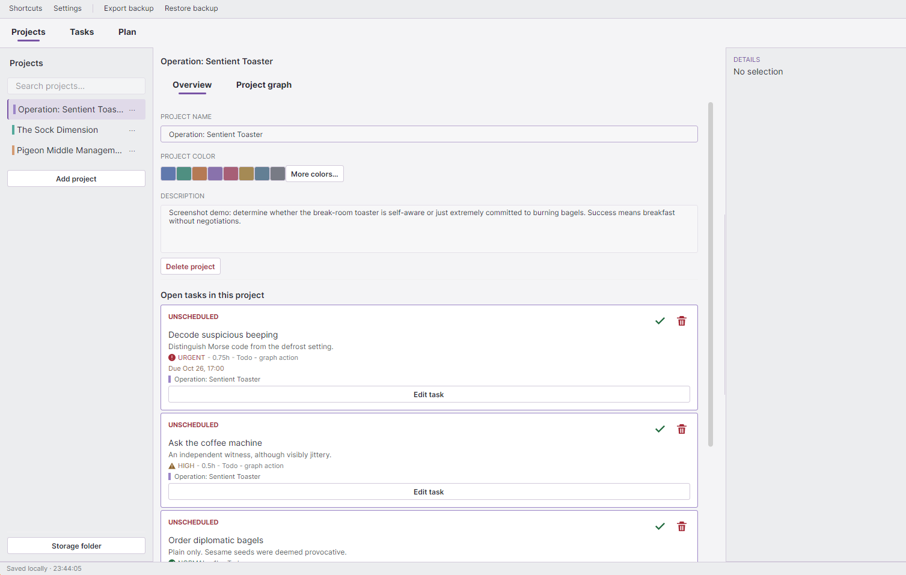
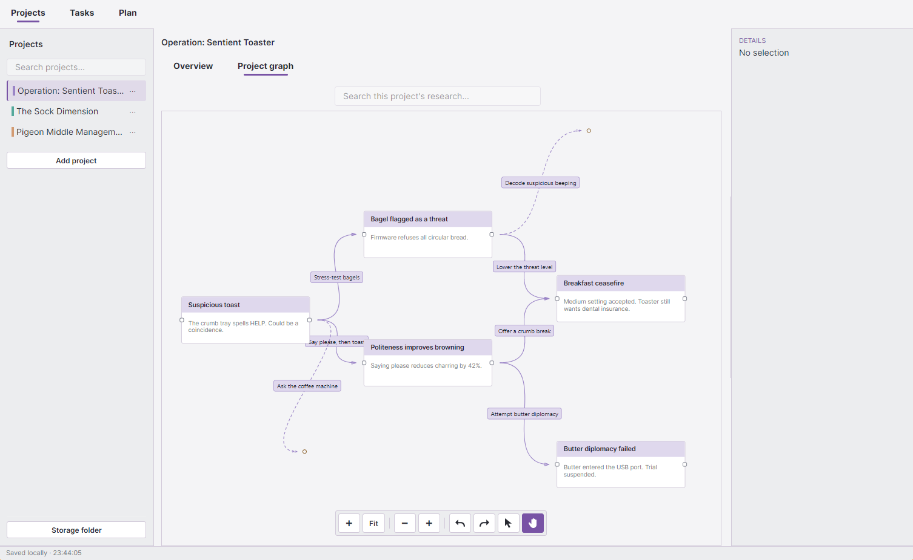
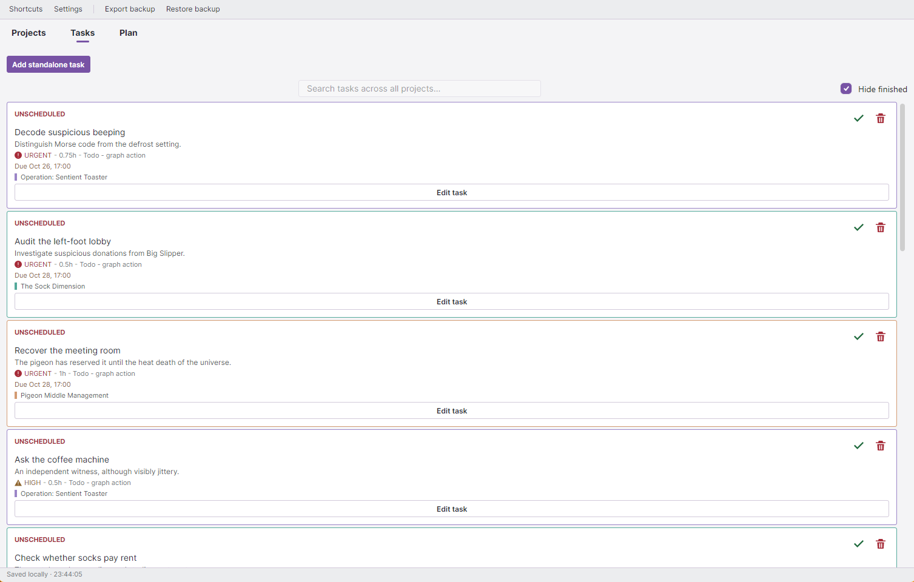
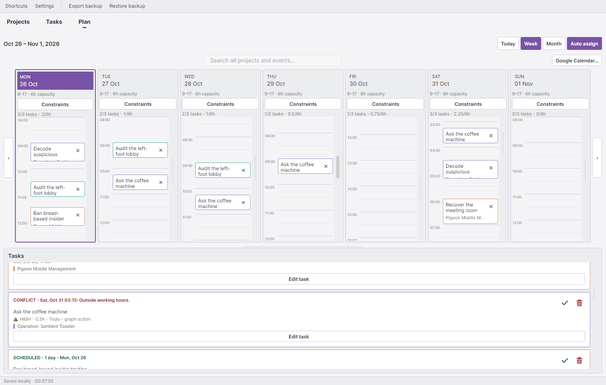

# Work Tracker

A native desktop app for managing work, project progress, tasks, and weekly plans. Built with C#/.NET 8, Avalonia UI, SukiUI, Nodify.Avalonia, and SQLite









## Run

Download the Windows x64 [desktop app](https://github.com/Shade9378/work-tracker/releases/latest/download/WorkTracker.Desktop.exe) and [CLI/MCP executable](https://github.com/Shade9378/work-tracker/releases/latest/download/work-tracker.exe). Keep them in one folder and double-click `WorkTracker.Desktop.exe`. No .NET installation is required.

## CLI

Run PowerShell in the main folder:

```powershell
.\work-tracker.exe --help
.\work-tracker.exe tasks list
.\work-tracker.exe tasks add --title "Review experiment"
```

## MCP

For Codex:

```powershell
codex mcp add work-tracker -- "$PWD\work-tracker.exe" mcp
```

Restart Codex afterward. For other MCP clients, use the full path to `work-tracker.exe` with arguments `["mcp"]` (STDIO).

Close Work Tracker before CLI/MCP writes. Data stays in `%LOCALAPPDATA%\ResearchTracker`.
